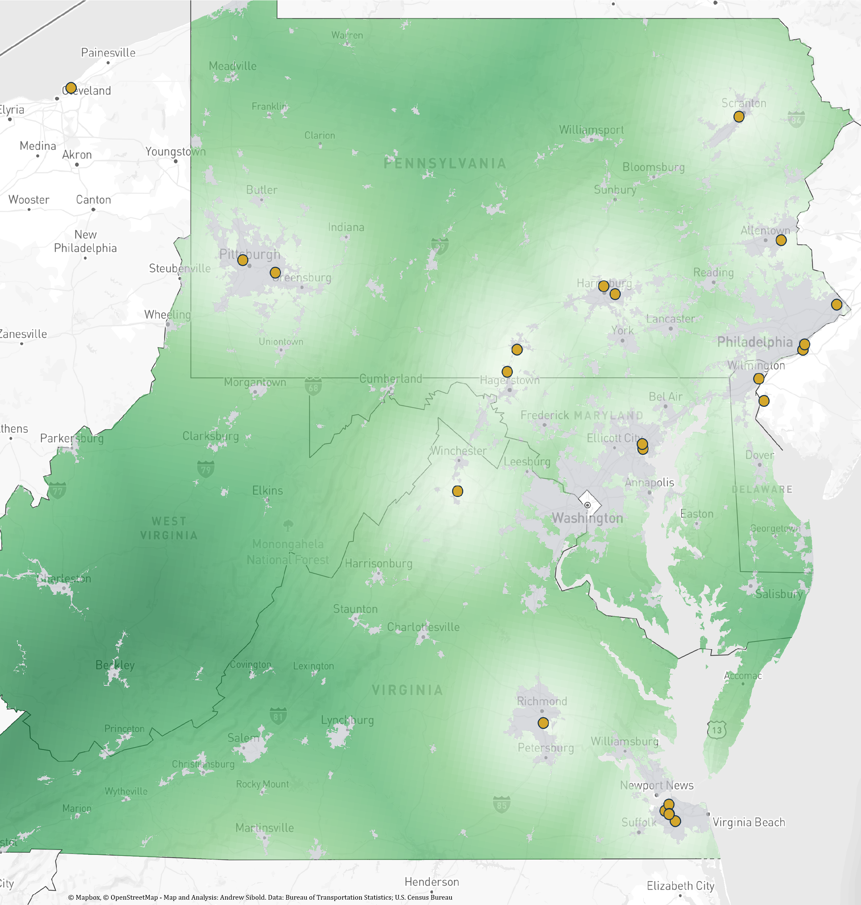

# Rural Access to Rail Intermodal Terminals in the Mid-Atlantic

An analysis of geographic access to intermodal infrastructure across the rural
territory of Pennsylvania, Maryland, Delaware, Virginia and West Virginia.

## 1. Question

**How does proximity to rail intermodal terminals vary across rural areas of
the Mid-Atlantic?**

Rail intermodal terminals, where trailers and containers transfer between truck
and train (TOFC/COFC), are the points at which a region connects to the
national intermodal network. This project measures how far rural territory sits
from the nearest such terminal and how that distance is distributed across five
states.

## 2. Map



*Darker green indicates greater straight-line distance to the nearest terminal.
Gold points are rail TOFC/COFC terminals. Grey areas are 2020 Census urban
areas, which are excluded from the analysis. Map and analysis: Andrew Sibold.
Data: Bureau of Transportation Statistics; U.S. Census Bureau. Basemap
© Mapbox, © OpenStreetMap.*

## 3. Finding

**Rural proximity to intermodal terminals follows the region's port and
interstate corridors, and declines steeply into the Appalachian interior.**
Terminals cluster at the coastal gateways (Hampton Roads, Baltimore, the
Delaware River) and along the Interstate 81 and Interstate 76/78 corridors
(Front Royal, Chambersburg, Greencastle, Harrisburg, Bethlehem, Scranton,
Pittsburgh). Rural land near these corridors is generally within 50 miles. The
most remote territory lies in central and southern West Virginia, where the
nearest terminals are outside the region (Columbus, OH; Georgetown, KY;
Front Royal, VA; Greensboro, NC) and distances reach 156 miles.

**Area-weighted shares of mapped rural territory beyond each threshold**

| Scope | Rural area (km²) | More than 50 mi | More than 100 mi |
|---|---:|---:|---:|
| **Study region** | 291,340 | **58.8%** | **17.9%** |
| West Virginia | 61,297 | 89.3% | 56.3% |
| Virginia | 97,818 | 62.2% | 17.7% |
| Delaware | 4,078 | 50.6% | 0.0% |
| Maryland | 21,806 | 43.5% | 0.2% |
| Pennsylvania | 106,341 | 41.6% | 0.2% |

**Distribution across display bands (study region)**

| Under 25 mi | 25 to under 50 mi | 50 to under 100 mi | 100 to under 150 mi | 150 mi or more |
|---:|---:|---:|---:|---:|
| 13.3% | 27.9% | 40.9% | 17.1% | 0.8% |

Three observations follow.

1. **West Virginia is the outlier.** It holds 21% of the region's rural
   territory but 66% of the rural territory more than 100 miles from a
   terminal.
2. **Distance beyond 100 miles is almost entirely a West Virginia and
   southwestern Virginia condition.** 93% of Virginia's territory beyond
   100 miles lies west of 79.5°W, where the nearest terminals are often in North
   and South Carolina (Greensboro, Charlotte, Greer). Pennsylvania, Maryland and
   Delaware each have less than 0.3% of rural territory beyond 100 miles,
   although 42% to 51% lies beyond 50 miles.
3. **State lines do not bound access.** 1,100 of the 3,366 rural polygons within
   10 km of the regional boundary are nearest to a terminal in another state.
   Restricting the search to in-region terminals would overstate distances in
   far-western West Virginia by as much as 200 miles.

These are shares of **territory**, not of residents, businesses or freight.
Each polygon carries the distance measured at one interior sample point, so the
shares are approximate. Water inside rural territory (2.0% of area) changes the
regional shares by less than 0.3 percentage points; land-only figures are in
[`results/rural_area_shares.csv`](results/rural_area_shares.csv).

## 4. Method

**Rural definition.** Rural territory is land in the five study states outside
2020 Census urban areas (Census Bureau 2022). State boundaries are the 2018
Census cartographic boundary file, which is clipped to the shoreline.

**Grid resolution.** A 5-km square grid is built in EPSG:5070 (NAD83 Conus
Albers, equal area), clipped to the study region, and differenced against urban
areas. Disconnected rural remnants of a cell become separate polygons, giving
15,787 rural polygons.

**Distance calculation.** Each polygon receives an interior representative
point. Distance to every candidate terminal is computed as a geodesic on the
WGS84 ellipsoid (`pyproj.Geod`), and the minimum is kept. Distances are
converted at 1,609.344 metres per mile. No distance is measured in degrees or
Web Mercator units.

**Terminal universe.** All 241 records in the Bureau of Transportation
Statistics NTAD Rail TOFC/COFC layer (published July 10, 2024) are candidates,
including terminals outside the study region. No filter is applied by railroad,
equipment or port, and operating status is not assumed. Inclusion criteria are
in [`docs/DATA_SOURCES.md`](docs/DATA_SOURCES.md).

**Area statistics.** Polygon areas are computed in EPSG:5070. Polygons are
intersected with state boundaries so that cells crossing a state line are
allocated by area. Water inside rural territory is identified with Census
TIGER/Line 2024 area-water polygons.

**Validation.** The pipeline runs five checks on every build and records them in
[`results/qa_report.json`](results/qa_report.json):

1. Rural polygons near known terminals report small distances.
2. Border polygons can select out-of-region terminals (500-polygon brute-force
   recheck, no mismatches).
3. Rural polygons do not overlap Census urban areas.
4. `distance_mi` is numeric in the exported file.
5. The most distant polygons are not the product of excluded or misplaced
   terminal records.

## 5. Limits

1. **Straight-line distance.** Distances are geodesic, not road or rail network
   distances. Mountainous terrain and river crossings make actual travel
   distances longer, most of all in the Appalachian interior where distances are
   already greatest.
2. **Facility-list completeness.** Results are only as complete as the BTS
   layer. Terminals that are missing, closed or newly opened are not
   reflected, and the source does not report operating status.
3. **Access is not service.** The analysis does not measure service
   availability (lanes, frequency, carriers), shipper demand, or trucking
   costs. A short distance to a terminal does not establish that useful service
   is available there.
4. **Sample-point approximation.** Each polygon takes the distance at one
   interior point. Within a 5-km cell the true distance varies by about 2 miles
   (median 2.05 mi in a 300-cell test), so area near the 50- and 100-mile lines
   may fall on either side.
5. **Mixed vintages.** State boundaries (2018), urban areas (2020) and terminals
   (2024) come from different years. State boundaries are stable, so the effect
   is immaterial at this resolution.

## 6. Next step

1. **Road-network access.** Replace straight-line distance with drive time or
   network distance over the road network, to capture terrain and
   river-crossing effects.
2. **Connections to economic activity.** Weight rural territory by population,
   establishments, agricultural and resource production, or freight
   origin-destination flows, to move from where access is limited to who and
   what is affected.

## Reproduce

Requires Python 3.11.

```bash
git clone https://github.com/andrewsibold-png/rural-intermodal-access.git
cd rural-intermodal-access
python -m venv .venv && source .venv/bin/activate   # Windows: .venv\Scripts\activate
pip install -r requirements.txt
```

1. Download the three source files listed in
   [`docs/DATA_SOURCES.md`](docs/DATA_SOURCES.md) into `Inputs/`.
2. Build the map layers and run validation:

   ```bash
   python prepare_rural_access.py              # fresh QA sample, seed logged
   python prepare_rural_access.py --seed N     # reproduce a prior QA sample
   ```

   Writes `Outputs/rural_access.geojson`, `urban_areas.geojson`,
   `terminals.geojson` (EPSG:4326, RFC 7946), plus `qa_report.json`,
   `metadata.json` and QA tables.
3. Compute the area statistics (downloads Census area-water files on first run):

   ```bash
   python analyze_rural_shares.py
   ```

4. Style the map: upload the three GeoJSON files to Mapbox Studio as tilesets
   and apply the style in [`map_style/`](map_style/).

## Repository

| Path | Contents |
|---|---|
| `prepare_rural_access.py` | Grid, rural definition, nearest-terminal distance, validation, GeoJSON export |
| `analyze_rural_shares.py` | Area-weighted shares, rural-land and water verification |
| `results/` | Finished map and verified summary statistics |
| `docs/DATA_SOURCES.md` | Download links, vintages, retrieval dates, terminal inclusion criteria |
| `map_style/` | Sanitized Mapbox style and tileset dependencies |

## References

U.S. Census Bureau (2022). "Urban Area Criteria for the 2020 Census: Final
Criteria." *Federal Register* 87(57): 16706-16715.

Bureau of Transportation Statistics (2024). *Intermodal Freight Facilities,
Rail TOFC/COFC.* National Transportation Atlas Database. Published July 10, 2024.
